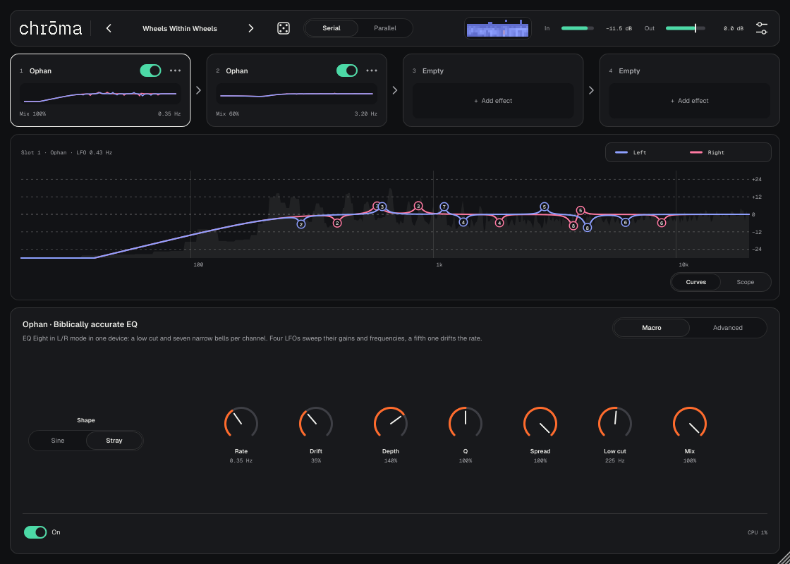
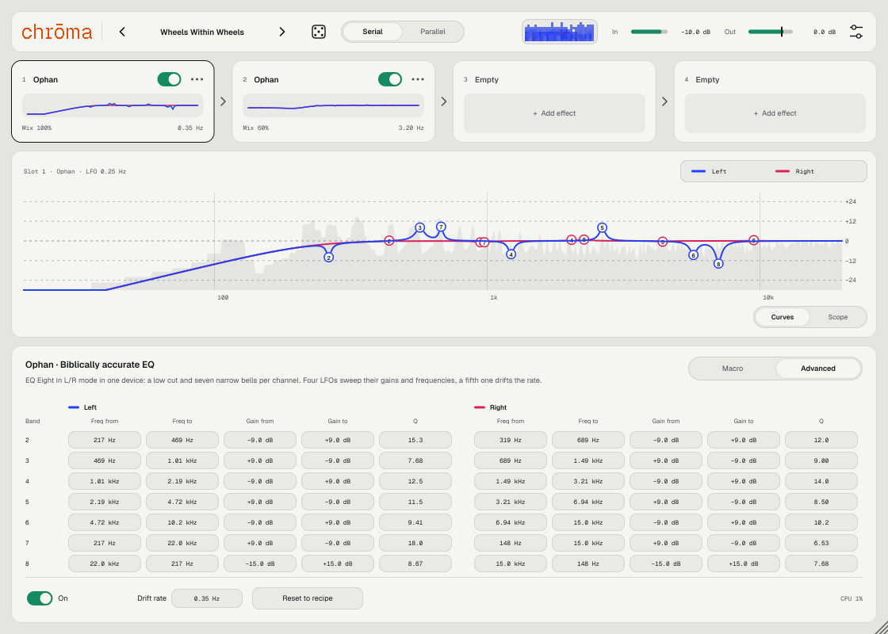
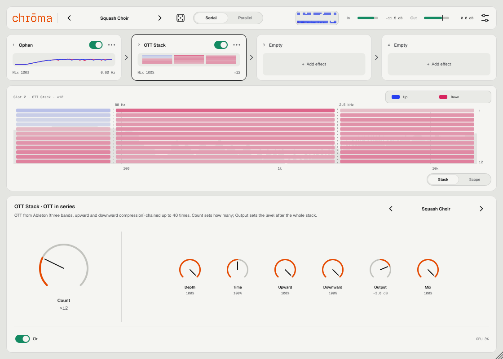
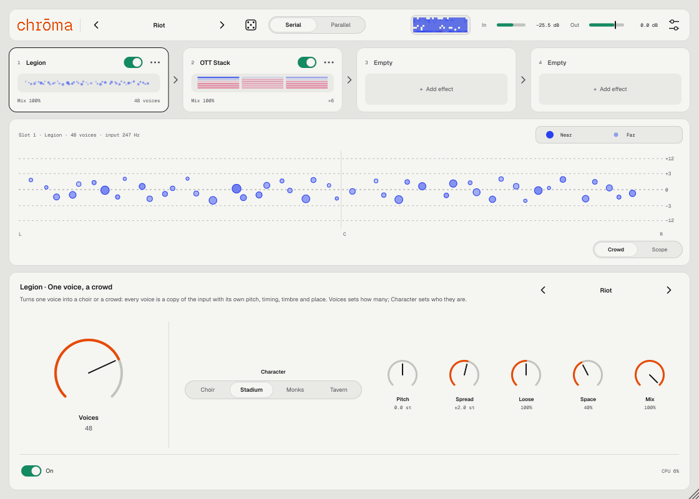

<p align="center">
  
</p>

<p align="center">
  
  
  
  
</p>

<p align="center">
  <a href="https://github.com/controloptioncommand/chroma-vst/releases/latest/download/chroma-macOS.zip"><b>⬇ Скачать chrōma для macOS</b></a>
</p>

---

**chrōma** — вайбкод-плагин: rack с экспериментальными эффектами обработки. Не базовые ревербы и дилеи, а приёмы, которые в DAW собираются из пяти устройств и десятка маппингов, — здесь они одним эффектом.

Брат [Mist](https://github.com/controloptioncommand/Mist-vst), [Eido](https://github.com/controloptioncommand/Eido-vst) и [Talk2Me](https://github.com/controloptioncommand/Talk2me): те же темы Oxygen и Rubber, шрифты Medeo и страница About.

## Rack

До восьми слотов, сигнал идёт слева направо. У каждого слота — переключатель On, Mix и свои ручки. Пока эффектов меньше четырёх, видно четыре места; как только их четыре — открываются все восемь, на экране четыре, остальные — прокруткой (колесо, трекпад или стрелки по краям rack).

- **Serial / Parallel** — переключатель в тулбаре. Serial: слоты по очереди, порядок слышен. Parallel: каждый включённый слот обрабатывает сухой вход, выходы усредняются (один слот звучит так же, как в Serial). Режим хранится в проекте и пресете.
- 🎲 **Кубик** в тулбаре: случайные ручки у эффектов, которые стоят в rack, в безопасных пределах. Тип эффекта, пустые слоты, On и громкость не трогает. Что ему можно менять — настройки → Randomizer: Ophan, OTT Stack, Legion, порядок слотов, Mix, рецепт полос Ophan (Advanced).

- Порядок — перетаскиванием карточек или в меню слота («⋯» или правый клик): Move left, Move right, Duplicate, Clear slot.
- Автоматизация привязана к слоту: переставили эффект — его дорожки автоматизации поехали вместе с ним.
- Выключенный или пустой слот пропускает звук без изменений.
- **Пресеты эффекта** — в заголовке панели слота `‹ имя ›`: свои и фабричные для каждого эффекта отдельно. Сохраняются ручки, Mix, у Ophan — Advanced, у Legion — характер; лежат в `~/Music/chroma/Presets/Effects/<эффект>/*.chromafx`.
- Настройки → Credits — страница с теми, кто вдохновил эффекты: @rosco.moon — Ophan, Ableton — OTT Stack.

## Ophan — Biblically accurate EQ

Первый эффект. Повторяет известный Ableton-рецепт, который обычно собирают из EQ Eight и пяти LFO:

| В Ableton | В Ophan |
|---|---|
| EQ Eight в режиме **L/R**: полоса 1 — срез низа, полосы 2–8 — колокола, Q 6–18, **Adaptive Q**, **Scale 200%** | То же внутри: срез низа и семь узких колоколов на каждый канал |
| LFO 1 → Gain левых полос, 20↔80% через полосу | LFO усиления, левый канал |
| LFO 2 → Gain правых полос | LFO усиления, правый канал |
| LFO 3 → Freq левых полос: 40–50, 50–60 … 80–90, 40–100, 100–40% | LFO частоты, левый канал |
| LFO 4 → Freq правых полос | LFO частоты, правый канал |
| Все четыре — **Stray**, скорости на макро Rate | **Shape** и **Rate** |
| LFO 5 (Stray, ~0.35 Гц, Mod 30–40%) → макро Rate | **Drift** |

Каналы двигаются независимо — колокола «бегают» по спектру и по стереобазе.

**Macro** — Shape (Sine / Stray), **Rate** (0.02–12 Гц), **Drift** (насколько плавает скорость), **Depth** (Scale EQ Eight, 0–200%), **Q** (25–400% от рецепта), **Spread** (0 — правый канал повторяет левый, 100% — независимы), **Low cut** (10 Гц – 2 кГц), **Mix**.

**Advanced** — весь рецепт числами: для каждой из 7 полос и каждого канала диапазон частоты (from → to), диапазон усиления и Q. Тянуть вверх/вниз, Shift — точнее, двойной клик — значение рецепта. Там же **Drift rate** и **Reset to recipe**.

<p align="center">
  
</p>

Честно о сходстве. Сетка и диапазоны взяты из видео, где рецепт показывают: частоты левого канала, Q, маппинги усиления и частоты, Scale 200%, скорость и глубина пятого LFO. Чего в видео не видно, подобрано на слух: «нечётные» частоты правого канала сдвинуты на полшага шкалы, часть Q правого канала, форма волны Stray (у Ableton свой генератор, здесь — свой) и степень Adaptive Q.

## OTT Stack — OTT подряд, от 2 до 40

Второй эффект. Тот самый приём «поставить OTT на OTT» — только без десятка одинаковых устройств на дорожке.

Один OTT здесь — как пресет OTT устройства Multiband Dynamics в Ableton: три полосы (кроссоверы 88.3 Гц и 2.5 кГц), в каждой сжатие вниз выше порога (1:66.7) и вверх ниже порога (1:4.17), затем подъём полосы.

- **Count** — главная ручка: сколько OTT стоит подряд, от 2 до 40. Меняется плавно — новые OTT въезжают по одному, без щелчков.
- **Output** — громкость после всей стопки (−48…+12 dB).
- Второстепенные: **Depth** (параллельная смесь каждого OTT, как у Xfer OTT), **Time** (атака и восстановление, 10–1000%), **Upward**, **Downward**, **Mix**.
- **Click guard** (в подвале панели, по умолчанию выключен) — защита от щелчка в начале ноты после тишины. Без неё стопка, как и OTT, первые миллисекунды поднимает ноту на 15–20 дБ; с ней начало ноты не громче входа, а звук после атаки тот же.

Каналы сжимаются вместе — стереокартина не плывёт. Вкладка **Stack** показывает работу каждого OTT по трём полосам: синее — подъём тихого, розовое — сжатие громкого.

<p align="center">
  
</p>

Честно о сходстве. Пороги, ratio, подъёмы полос, атаки и восстановления — по пресету OTT в Ableton. Две вещи добавлены, чтобы 40 OTT подряд оставались музыкой: у каждого OTT есть мягкий потолок +6 dBFS (ниже 0 dBFS звук не трогается), иначе атаки копят по +10 дБ на каждой ступени. А ниже −84 dBFS стопка ничего не поднимает — иначе шум и хвосты вырастают до громкости музыки. 40 OTT — это около 12% одного ядра.

## Legion — хор или толпа из одного голоса

Третий эффект. Спойте или крикните одним голосом — Legion сделает из него церковный хор, футбольную трибуну, монахов в соборе или пьяную таверну.

- **Voices** — главная ручка: сколько голосов, от 2 до 64. Меняется плавно, громкость от числа голосов не растёт.
- **Character** — кто поёт: **Choir** (вместе, мягкое вибрато, большой зал), **Stadium** (кричат, вразнобой, дальние голоса глуше, открытое поле и эхо от трибун), **Monks** (строгий унисон, тёмный собор), **Tavern** (мимо нот и мимо доли, маленькая комната).
- **Pitch** — сдвиг высоты всей толпы, −12…+12 полутонов: мужской хор из женского голоса и наоборот.
- **Spread** — разброс высоты между голосами, ±0…12 полутонов: от хора в унисон до толпы, где каждый кричит в своём тоне.
- **Loose** — насколько вразнобой по времени и строю (0–200%), **Space** — пространство, **Mix**.

Каждый голос — копия входа со своей высотой, опозданием, тембром, местом в стерео и дальностью. Высота меняется методом TD-PSOLA: вход режется на кусочки по два периода тона и собирается с новым шагом, поэтому форманты остаются на месте и голос не становится «мультяшным». Вкладка **Crowd** показывает толпу: каждый кружок — голос, по горизонтали стерео, по вертикали высота.

<p align="center">
  
</p>

Честно об ограничениях. Legion следит за **одним** голосом: тон входа он узнаёт сам (70 Гц – 1 кГц). На аккордах, барабанах и шуме тона нет — голоса меняют только тембр, время и место, высоту — нет. Голоса толпы опаздывают нарочно (как живые люди), хосту эта задержка не сообщается. 64 голоса — около 6% одного ядра.

## Окно

- **Curves** (у Ophan) — живые кривые левого (синий) и правого (розовый) канала выбранного слота с номерами полос поверх спектра выхода. **Stack** (у OTT Stack) — карта ступеней. **Crowd** (у Legion) — голоса толпы. **Scope** — волна на выходе.
- На карточках слотов — миниатюры кривых, карты ступеней или толпы, Mix и скорость LFO, число OTT или число голосов.
- В тулбаре уровни **In** и **Out** (громкость — перетаскиванием по шкале), мини-спектрограмма — просто для красоты.

## Пресеты

25 фабричных. Ophan: Biblically Accurate (рецепт один в один), Twerking, Gentle Halo, Sine Choir, Mono Prayer, Glossolalia, Thin Air, Wheels Within Wheels, Six Wings, Be Not Afraid. OTT Stack: Double OTT, Tower of Babel (×40), Gentle Glue, Squash Choir (Ophan → OTT ×12), Angel Crush (OTT ×24 → Ophan). Parallel: Ophanim (два Ophan на одном входе). Legion: We Are Many, Hallelujah, Basso Profondo (мужской хор на октаву ниже), Monastery, Terraces (трибуна на 64 голоса), Sirens (трибуна болельщиц), Last Orders, Pandemonium, Riot (трибуна → OTT ×6). Пресет хранит весь rack: слоты, порядок, режим и Advanced. Свои — меню пресета → Save preset, лежат в `~/Music/chroma/Presets/*.chroma`.

## Две темы

**Oxygen** — светлая, **Rubber** — тёмная, или по системе: иконка настроек → Appearance. Там же размер окна.

## Установка

1. Скачайте **[chroma-macOS.zip](https://github.com/controloptioncommand/chroma-vst/releases/latest/download/chroma-macOS.zip)** и распакуйте.
2. В Терминале:
   ```bash
   bash ~/Downloads/chroma-macOS/install-mac.sh
   ```
   Скрипт кладёт `chroma.vst3` и `chroma.component` в `~/Library/Audio/Plug-Ins` и снимает карантин macOS: плагин подписан ad-hoc, без сертификата Apple.
3. Перезапустите Ableton или Settings → Plug-Ins → Rescan. chrōma — аудиоэффект: кладите его на любую дорожку.

В архиве есть папка `demo`: сухой сигнал и он же через пресеты, для Legion — синтетический поющий голос. Подробное руководство — **[chroma-manual.pdf](docs/chroma-manual.pdf)**, оно же лежит в архиве релиза.

Нужен Mac на Apple Silicon и macOS 11 или новее. Каждое изменение в `main` автоматически собирается, проходит pluginval и auval и выкладывается в [Releases](https://github.com/controloptioncommand/chroma-vst/releases).

## Сборка

```bash
cmake -B build -DCHROMA_BUILD_TESTS=ON && cmake --build build --config Release --target chroma_VST3 chroma_AU ChromaTest
./build/ChromaTest_artefacts/Release/ChromaTest ./render
```

JUCE 8 скачивается автоматически.

Руководство в PDF собирается из `docs/manual/chroma-manual.html`: тест снимает свежие скриншоты, Chromium печатает PDF в `docs/chroma-manual.pdf` (нужны Python 3 с Pillow и Node.js с Playwright):

```bash
bash docs/manual/build.sh
```

Тест проверяет фильтры и LFO, ровность кроссоверов OTT Stack, сжатие и тишину на 40 ступенях, у Legion — тон входа, сдвиг высоты с формантами на месте и ровную громкость при любом числе голосов, рендерит Ophan на разных частотах дискретизации (не тишина, не NaN, не выше 0 dBFS, каналы различаются), обход пустых и выключенных слотов бит-в-бит, крайние значения, порядок цепочки, режим Parallel (одна ветка = Serial бит-в-бит, всё выключено = сухой сигнал, смена режима на ходу), 40 бросков кубика, сохранение состояния, все пресеты, скорость, пишет демо-WAV и снимает скриншоты интерфейса.

## Устройство

| Где | Что |
|---|---|
| `Source/DSP/Ophan.*` | Ophan: SVF-фильтры, рецепт, пять LFO |
| `Source/DSP/OttStack.*` | OTT Stack: кроссоверы Linkwitz–Riley, сжатие вверх и вниз, до 40 ступеней |
| `Source/DSP/Legion.*` | Legion: детектор тона YIN, до 64 голосов TD-PSOLA, характеры толпы, пространство (FDN) |
| `Source/DSP/Svf.h` | SVF-фильтры (Simper): колокол, срезы, фазовращатель |
| `Source/DSP/Lfo.h` | LFO: Sine и Stray |
| `Source/PluginProcessor.*` | Rack: слоты, порядок, Serial / Parallel, состояние, метры |
| `Source/Randomizer.*` | Кубик и его «безопасные» диапазоны |
| `Source/EffectPresets.*` | Пресеты одного эффекта: фабричные и свои |
| `Source/Params.*`, `Source/Presets.*` | Параметры слотов и пресеты |
| `Source/UI/` | Интерфейс, темы Oxygen / Rubber, карточки rack, кривые, толпа, панели эффектов, About |

Написан на C++ и [JUCE 8](https://juce.com). Чужой код и данные — в [THIRD_PARTY.md](THIRD_PARTY.md).

<p align="center"><sub>made by nnn · vibe-coded with Claude</sub></p>
